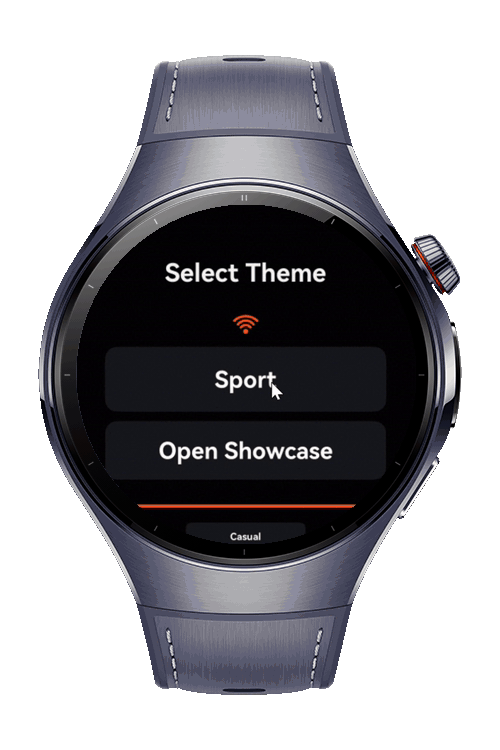
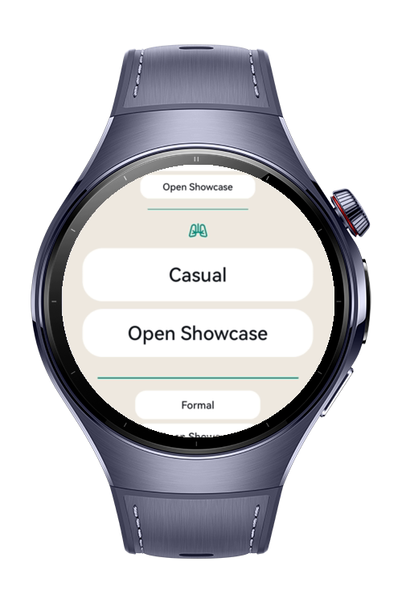
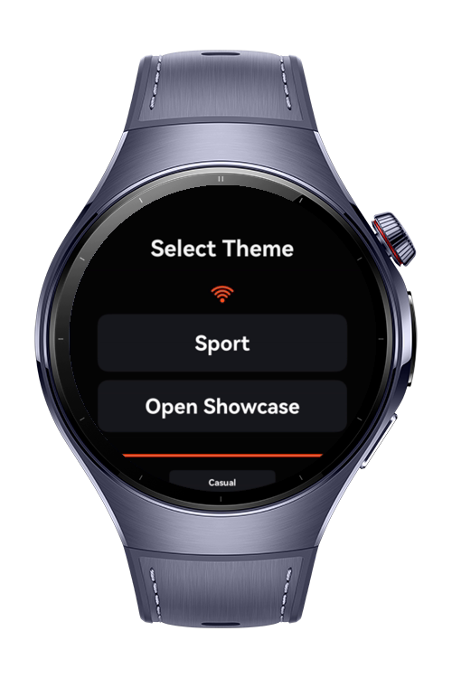
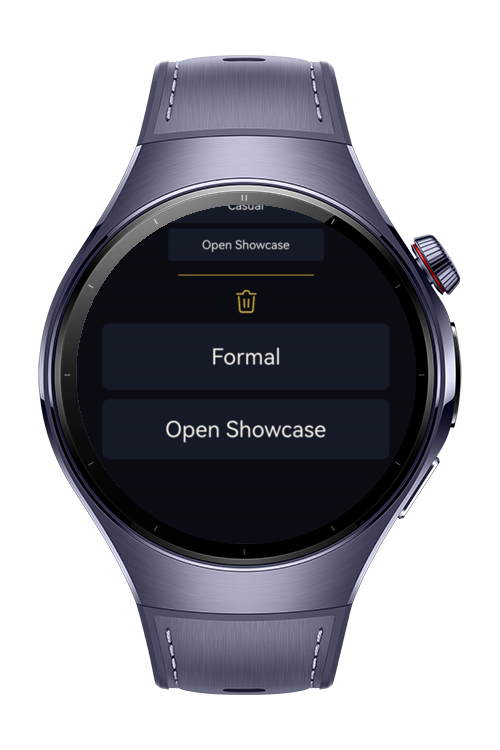

> **Note:** To access all shared projects, get information about environment setup, and view other guides, please visit [Explore-In-HMOS-Wearable Index](https://github.com/Explore-In-HMOS-Wearable/hmos-index).

# How to Build Modifier Toolkit

A HarmonyOS NEXT application for smartwatches that demonstrates a live theme engine built entirely on ArkUI modifiers. Built with ArkTS and ArkUI, it lets users switch between Sport, Casual, and Formal watch themes and watch every component restyle itself in real time through Attribute, Content, Draw, Divider, Gesture, and Symbol Glyph modifiers all designed for the round watch screen.

# Preview

<div>
  
  
  
  
</div>

# Use Cases

- Switch between Sport, Casual, and Formal themes from a round-screen theme picker.
- See the entire UI restyle instantly when the active theme changes.
- Open a per-theme showcase that opens directly in the selected theme.
- Restyle component attributes (color, corner radius, font, pressed state) at runtime via the Attribute modifier.
- Replace a Gauge's content area with a themed custom rendering via the Content modifier.
- Draw theme-specific decorations behind or over a card (stripes / frame) via the Draw modifier.
- Style arc-list row separators per theme via a custom Divider modifier.
- Cycle themes by swiping a demo area via the Gesture modifier.
- Show a themed symbol icon on the active theme row via the Symbol Glyph modifier.

# Technology

## Stack

* Languages: ArkTS, ArkUI
* Frameworks: HarmonyOS SDK 6.0.1
* Tools: DevEco Studio, Hvigor
* Libraries:
    * `@kit.ArkUI`
        * Attribute Modifier
        * Content Modifier
        * Drawing Modifier
        * DividerModifier
        * Gesture Modifier
        * Symbol Glyph Modifier

# Directory Structure

```
entry/src/main/ets/
├─ pages/
│  ├─ Home.ets
│  └─ ShowcasePage.ets
├─ components/
│  ├─ ThemedButton.ets
│  └─ ThemedCard.ets
├─ modifiers/
│  ├─ ThemedAttributeModifier.ets
│  ├─ ThemedContentModifier.ets
│  ├─ ThemedDrawModifier.ets
│  ├─ ThemedDividerModifier.ets
│  ├─ ThemedGestureModifier.ets
│  └─ ThemedSymbolFactory.ets
├─ viewmodel/
│  └─ ThemeViewModel.ets
├─ navigation/
│  └─ NavigationService.ets
└─ model/
   ├─ ThemeType.ets
   ├─ ThemeDefinition.ets
   ├─ ThemeRepository.ets
   └─ WatchSpacing.ets
```

# Constraints and Restrictions

## Supported Devices

* Huawei Watch 5

## Limitations

* ArcList and ArcListItem require API version 18 or later.

# License

How to Build Modifier Toolkit is distributed under the terms of the MIT License.

See the [LICENSE](LICENSE) file for more information.